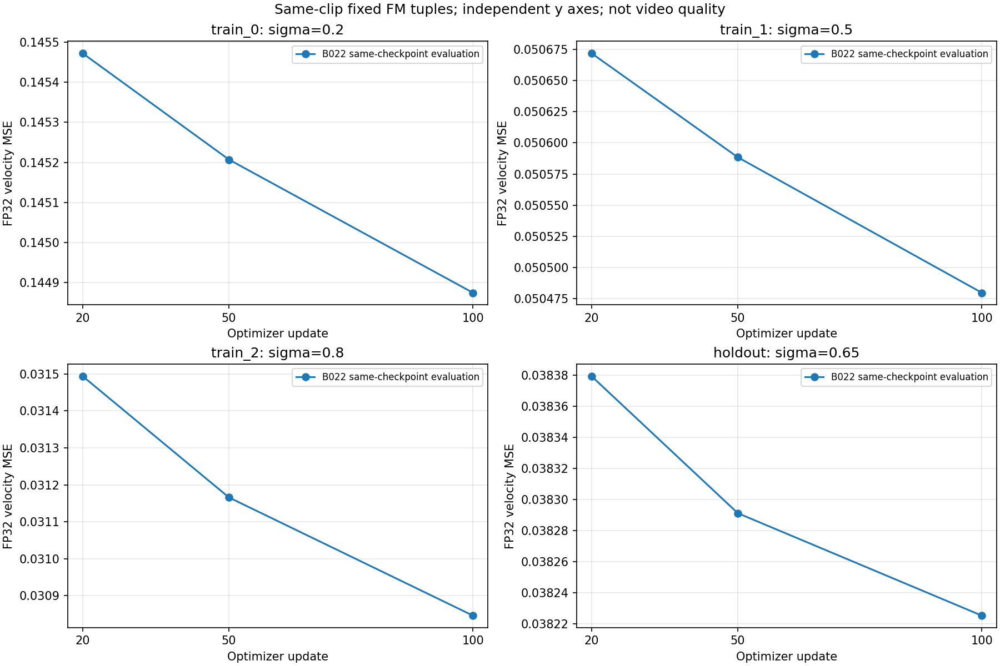

# B-022 결과 — 학습 완료, 영상 비교 진행 중

B-021의 STOPPED_AT_REPLAY_20과 엄격한 adapter replay FAIL은 보존한다. B-022는 그 유효한20회 checkpoint의 optimizer/RNG/cursor를 포함한 재개 실험이다.

## 완료한 기술 검증

- restart20 payload 및18개 tensor가 B-021과 byte-identical. q.A/q.B/v.A/v.B와 AdamW moment·step20·RNG·cursor2를 복원했다. update21은 train_2다.
- 실제 추가80update, 누적100에서 종료. durable row는21..100이며 기존 B-021의 누락된20번째 row는 만들지 않았다.
- 비학습 tail forward33/40, 진단 backward3/3. P와 prefix 재계산0, 재시도0.
- fresh module의20회 네 tuple reload/OFF와100회 종료 검사: 원시 max_abs0, 기존 atol=rtol1e-3 유지.
- 이번 worker의 frozen base/source storage 불변 PASS. B-021 과거 종료 검사는 여전히 NOT_REACHED.

독립 검증: [TRAIN_REVIEW.json](TRAIN_REVIEW.json). 실행 코드는 preregistered commit `76bf4d0a159ca6bd06c1e7dbb810b2b4bfc8b96e`에서 고정했다.

## 고정 FM 평가

| tuple |20|50|100|
|---|---:|---:|---:|
|train_0|0.1454722583|0.1452070177|0.1448749900|
|train_1|0.0506718382|0.0505884141|0.0504798330|
|train_2|0.0314944424|0.0311658792|0.0308459513|
|holdout|0.0383793972|0.0382911973|0.0382253155|

세 training tuple과 같은 clip holdout의 경험손실은 감소했다. 서로 다른 sigma의 loss를 하나의 하강곡선으로 해석하지 않는다. holdout은 독립 영상/개체 test가 아니다. D=Y의 복사 shortcut은 남는다.

## 수치 진단

B-02020과 B-02120의 최종 velocity RMS 차이는0.000538–0.000768, max_abs는0.03125였다. 유사한 scalar MSE는 함수 동등성의 증거가 아니다. 같은 상태의 무update 반복3회는 prediction 차이0, gradient 최대 차이2.2828e-10이었다. 이는 tail 전체 경로의 관측이며 FA2 단독 원인은 UNKNOWN이다. 고정4개 probe의 BA 작용 검사는 전 입력에 대한 동등성 증명이 아니다.

## 영상

현재 matched20/100의 각1회 sampler/decode 진행 중. 영상 품질은 미판정, temporal=UNVERIFIED다. 학습 성공을 영상 성공으로 표시하지 않는다. 기존 B-02020회 영상은 역사 맥락으로만 보존한다.

## 남은 검증 한계

전체 정적 typing은 NOT_CLEAN(755 errors)이며 세부 CPU 검사와 inherited dynamic import 진단을 [CPU_VALIDATION.md](CPU_VALIDATION.md)에 기록했다. 억제나 전체 타입 리팩터링은 하지 않았다. 이번 검사는 한 clip·세 fixed tuple과 마지막block Q/V rank4에 한정된다.
